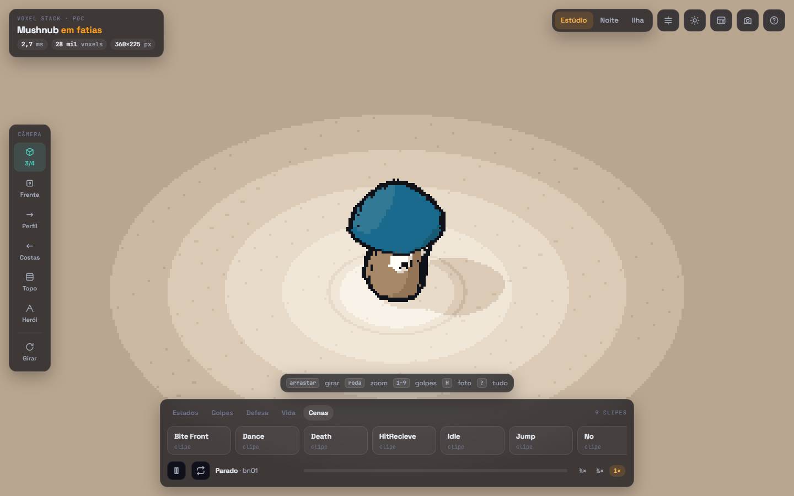
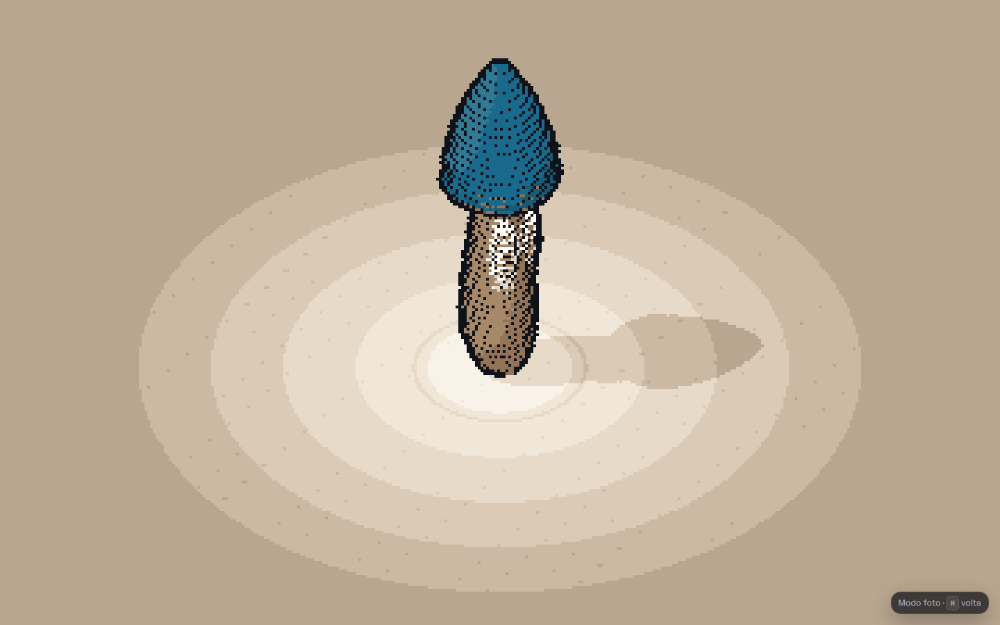
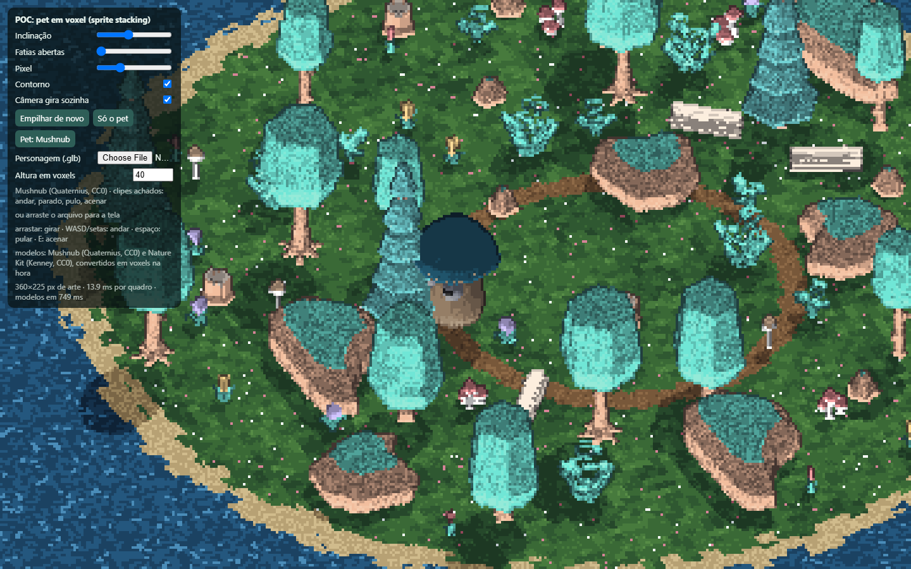
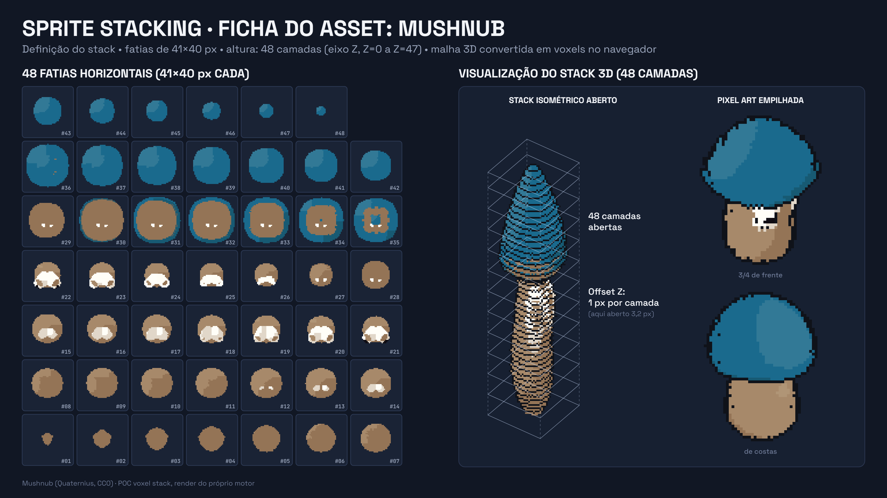

# POC Voxel Stack

**Sprite stacking no navegador a partir de uma malha 3D.** Um modelo `.glb` (com esqueleto, animações e texturas) vira uma grade de
voxels; cada camada z da grade é uma fatia plana, girada e desenhada 1 px acima da anterior. O resultado é pixel art que gira em
qualquer ângulo, acende por voxel a cada quadro e anima. Páginas HTML únicas, sem build.

*English: a browser sprite-stacking proof of concept. A rigged, animated, textured `.glb` mesh is voxelized and drawn as flat slices
stacked 1 px apart, so the pixel-art model turns to any angle, is lit per voxel every frame, and plays its animations. Single HTML
pages, no build step. Docs are in Portuguese.*



| as fatias abertas (tecla X) | a POC original na ilha |
|---|---|
|  |  |



## O que tem

- **Malha para voxels no navegador:** o three.js lê o `.glb` e posa o esqueleto (`AnimationMixer.setTime`); os triângulos são
  rasterizados numa grade, o interior é preenchido por flood fill, e cada voxel guarda cor (da textura, pela média das amostras),
  normal suave e oclusão.
- **Render de sprite stacking escrito do zero:** rasterização inversa das fatias, buffer de profundidade pela altura, luz por voxel
  (o sol fica parado enquanto o modelo gira), sombra projetada, contorno e paleta por pares (material, nível).
- **Animação:** cada pose é um modelo voxel; os clipes viram quadros (12 por segundo de clipe), convertidos na primeira vez e
  guardados. O deslocamento do corpo no chão sai do clipe, e quem anda é a cena.
- **O estúdio (`estudio.html`):**
  - cenas Estúdio, Noite e Ilha;
  - presets de câmera (3/4, Frente, Perfil, Costas, Topo, Herói) e órbita com inércia, roda e pinça;
  - doca de animações por categoria, com barra de progresso;
  - congelar o tempo com a câmera girando, e câmera lenta (¼× e ½×);
  - sol ajustável ao vivo;
  - explosão das fatias (X) e modo foto (H);
  - celular.
- **A ficha do asset:** um botão monta, a partir do próprio render, a folha com todas as fatias vistas de cima, o stack aberto em
  isométrico e as vistas de frente e de costas (3840×2160).
- **O personagem do DSTS** (`agumon.html` e o estúdio, quando o `.glb` está na pasta):
  - o rosto composto como no jogo (pele, íris e pálpebra);
  - cel em dois tons, dentes e garras brancos;
  - piscar, e brilho do olho que segue a câmera;
  - as 33 animações com os nomes da tabela do dsts-viewer.

## Rodar

```bash
python -m http.server 8820 --bind 127.0.0.1
```

Abra uma das páginas (o three.js vem do jsDelivr, então é preciso internet):

| página | o quê |
|---|---|
| http://localhost:8820/estudio.html | o estúdio: a interface completa e a ficha do asset |
| http://localhost:8820/agumon.html | a página de validação do personagem, com o painel simples |
| http://localhost:8820/index.html | a POC original: o Mushnub e o Nature Kit (Kenney) na ilha |
| http://localhost:8820/index_v1_procedural.html | a primeira versão, com o pet e os objetos montados por formas no código |

Também dá para arrastar qualquer `.glb` para a página, ou escolher um em "Outro .glb" (o arquivo não sai da máquina).

## O modelo do DSTS não vem no repositório

O `assets/agumon.glb` é o export do `chr050` (Agumon) de *Digimon Story Time Stranger* (Bandai Namco), feito com o
[dsts-extractor](https://pypi.org/project/dsts-extractor/) a partir de uma cópia própria do jogo. Ele não está no repositório, nem as
capturas e as fichas geradas dele (`.gitignore`). Para usar, gere o seu:

```bash
dsts export chr050 --optimized -o <pasta>
```

e copie o `.glb` para `assets/agumon.glb`. **Sem ele, as páginas carregam o Mushnub (Quaternius, CC0)**, que vem junto. As imagens
deste README foram feitas assim.

## A ficha e as capturas por script

Com o servidor rodando:

```bash
npm install
npx playwright install chromium
node tools/gerar_ficha.cjs ficha.png 63      # a ficha do modelo carregado; 63 de altura dá 64 camadas
node tools/capturas_readme.cjs               # as imagens de docs/ (rode sem o assets/agumon.glb)
```

## Estrutura

```
estudio.html               o estúdio (motor + interface + ficha)
agumon.html                a página de validação do personagem do DSTS
index.html                 a POC original (Mushnub e Nature Kit)
index_v1_procedural.html   a versão 1, com modelos montados por formas
assets/                    os modelos CC0 (Mushnub, Nature Kit) e, só local, o agumon.glb
tools/                     a ficha e as capturas por Playwright
docs/                      as imagens do README
LEIA.md                    a documentação técnica completa, etapa por etapa
```

## Créditos e licença

- A técnica é inspirada no [moon-stack](https://git.patch.gg/rehan/moon-stack), de rehan. O código daqui foi escrito do zero, porque
  a licença do Patch não permite tirar código de lá.
- Mushnub: [Quaternius](https://quaternius.com), CC0 (`assets/Mushnub_LEIA.txt`). Nature Kit: [Kenney](https://kenney.nl), CC0
  (`assets/Kenney_License.txt`).
- Os nomes dos clipes do DSTS vêm da tabela `data/animation_names.json` do dsts-viewer (nuffle.me, MIT).
- Agumon e Digimon Story Time Stranger © Bandai Namco. Nenhum asset do jogo está neste repositório.
- O código desta POC não tem licença aberta: todos os direitos reservados.
